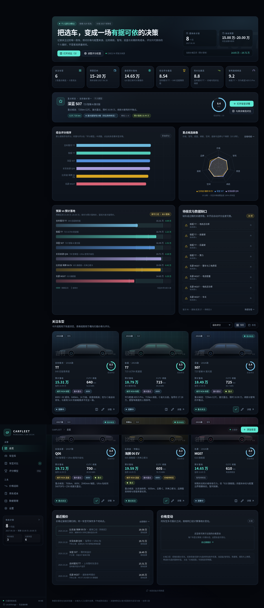

# CARFLEET · 个人选车工作台



一个面向个人长期使用的选车管理前端：记录关注车型、核对配置与价格来源、横向对比参数、按个人偏好加权评分，并测算长期持有成本。

- 纯前端、无后端依赖，数据保存在浏览器 `LocalStorage`
- 初始录入 6 款车型，其中 **深蓝 S07、长安启源 Q06、比亚迪海狮 06 EV** 标记为重点候选
- 价格、参数、评分、备注、对比清单、成本假设刷新后不丢失
- 重点处理了「数据真实性」：无法核实的字段显示 **待核实**，不编造实时价格；官方/媒体/实测/个人口径分开标注

> 这是个人决策辅助工具，不是车型评测榜单。页面中的评分是**个人偏好模型**，初始手动分数为示例占位，需按试驾和实车体验校准。

---

## 1. 快速开始

### 环境要求

- Node.js `>= 20.19`（推荐 22 LTS 或 24；本项目在 Node 24 下构建验证）
- npm `>= 10`
- 现代浏览器（Chrome / Edge / Safari / Firefox 近两年版本）

### 安装与启动

```bash
npm install
npm run dev
```

打开终端输出的地址（默认 http://127.0.0.1:5173）。

### 构建与预览

```bash
npm run build
npm run preview
```

静态托管部署时，需要把未知路径回退到 `index.html`（SPA history fallback），否则直接刷新 `/garage/xxx` 会 404。

### 类型检查

```bash
npm run typecheck
```

> 预算默认设为 15–20 万、计划购车日期默认 2027-06-30，均为可修改的初始假设。
>
> 首次安装如果 npm 报缓存目录只读，可指定本地缓存：
> `npm --cache ./.npm-cache --logs-dir ./.npm-logs install`

---

## 2. 功能地图

| 页面 | 主要能力 |
| --- | --- |
| 总览 | 关注数/重点候选数、预算区间、最低落地、评分最高、性价比最高、智驾最强、价格区间、待核实缺口、评分图、预算 vs 落地、卡片/表格切换 |
| 车型库 | 搜索、状态/类别/重点筛选、排序、卡片/表格视图、新增/编辑/删除、封面、标签、笔记 |
| 车型详情 | 概览、价格、车款、三电、空间、底盘、舒适、智驾、安全、笔记、来源；参数完整度；报价历史 |
| 车型对比 | 2–6 款车型、15 个维度、固定表头、最优/较优/待核实、选装标识、列排序、隐藏无差异、CSV 导出 |
| 评分模型 | 7 维权重（自动归一化）、手动/自动评分、硬性筛选、排名升降、快照、评分依据展开 |
| 价格追踪 | 多时间点报价、逐项落地价、税政口径、价格趋势、最新报价一览、价格变动 |
| 用车成本 | 年限/里程/家充比例/电价/电耗/保险/保养/轮胎/维修/残值/机会成本，5 年总成本、每公里成本、曲线 |
| 数据管理 | JSON 全量导出/导入（校验+预览+合并/替换）、车型 CSV、存储占用、恢复示例、清空 |
| 设置 | 预算、购车日期、城市、税政口径、默认保险/上牌、过期提醒、偏好模型入口 |

### 数据真实性设计

- 每个参数都可以标注：**官方 / 媒体 / 经销商 / 实测 / 个人 / 待核实**，并记录来源 URL、核实日期、测试条件、备注。
- 来源链接单独维护，参数通过 `sourceId` 关联到来源；修改来源 URL 后参数引用同步。
- 缺失数据在详情、对比、评分中显示「待核实」，不按 0 分处理；自动评分会把缺失项从分母中剔除，并展示覆盖度。
- 对比表的「最优/较优」只是数值机械判断，页面明确提示「配置多 ≠ 体验好」。
- 价格采用**保守口径**：现金优惠默认计入；附加条件优惠、置换补贴默认不计入，勾选后会在报价记录中明确标注。
- 纯电车型不默认免税：按计划购车日期计算购置税。

---

## 3. 初始车型与核实状态

核实基准日期：**2026-10-28**。数据主要来自品牌官方页面、官方配置表、汽车之家/易车/新华网/IT之家等。部分车型的版本名称、年款或价格口径存在冲突，已在车型备注和报价条件中标记。

| 车型 | 版本 | 类别 | 指导价 | 当前/参考价 | CLTC | 关键备注 |
| --- | --- | --- | ---: | ---: | ---: | --- |
| 极狐 T7 | 715 ULTRA 乾崑版 | SUV | 17.28 万 | 16.88 万上市补贴价 | 715 km | 官方名为「极狐 阿尔法T7」；16.88 万含 4000 元置换补贴 |
| MG07 | 610 旗舰版 | 轿车 | 13.69 万 | 13.39 万起 | 610 km | **版本名称/年款待核实**；预售口径 14.59 万与上市后媒体口径 13.69 万冲突 |
| 银河 TT | 640 后驱尊贵版 | 轿车（C 级运动轿车） | 14.99 万 | 13.99 万限时先享价 | 640 km | 名称正确；类别是轿车，不是 SUV |
| 深蓝 S07 | 725 智臻 AI 激光版 | SUV | 17.59 万 | 16.99 万限时权益价 | 725 km | 2026-09-30 上市；AI 激光版限时免费开通 1.5 万元智驾 |
| 长安启源 Q06 | 700 智尊型 + Ultra 智驾升级包 | SUV | 16.99 万 | +1.20 万 Ultra 包 | 700 km | Ultra 包：560TOPS、256 线激光雷达、端到端领航 |
| 比亚迪海狮 06 EV | 605 旗舰版 + 天神之眼 B | SUV | 16.09 万（反推） | 18.09 万（媒体口径） | 605 km | **官方配置器未检到「605 旗舰版」同名校验，年款/版型/价格待核实** |

### 主要来源

- 极狐阿尔法T7 官方产品页：https://www.arcfox.com.cn/T7/index.html
- 极狐阿尔法T7 官方配置表：https://www.arcfox.com.cn/deployment-ARCFOXT7.html
- 易车 T7 报价：https://car.m.yiche.com/arcfox-289/m191577/
- MG 07 官方页：https://www.saicmg.com/vehicles/sedan/mg07.html
- 新浪汽车 MG07 预售：https://auto.sina.cn/2026-07-30/detail-inikqcsr1970779.d.html
- 汽车之家 MG 07 610 旗舰版参数：https://car.autohome.com.cn/config/spec/76774.html
- 吉利银河 TT 官方页与配置表：https://www.galaxy-geely.com/YHTT
- 新华网 深蓝 S07 上市：http://www.news.cn/auto/20260930/c6172e7c4dbe4cbb8a1ebb6870f2a316/c.html
- IT之家 深蓝 S07 价格：https://www.ithome.com/1/008/019.htm
- 汽车之家 深蓝 S07 参数：https://car.autohome.com.cn/config/series/6817.html
- 汽车之家 启源 Q06 700 智尊型：https://car.autohome.com.cn/config/spec/78819.html
- 搜狐汽车 Q06 报价：https://db.m.auto.sohu.com/trim_183940
- 网通社 Q06 空间/三电：https://auto.news18a.com/7026/
- 比亚迪海狮06EV 官方页：https://www.byd.com/cn/ocean-home/models/haishi/haishi-06-ev
- 比亚迪海狮06EV 官方参数表：https://www.byd.com/cn/parameter-comparison?goodsId=10036
- 新浪：海狮06EV 天神之眼B 选装分析：https://www.sina.cn/gc/article/nivziwc6047882.html

### 购置税口径

按财政部/税务总局/工信部公告：

- 2024-01-01 至 2025-12-31：免征，减税额上限 3 万元/辆
- **2026-01-01 至 2027-12-31：减半征收（实际 5%），减税额上限 1.5 万元/辆**
- 2028 起：本工具默认按 10% 全额估算

官方原文：https://fgk.chinatax.gov.cn/zcfgk/c102416/c5207352/content.html

计算方式：`不含税价 = 含税成交价 ÷ 1.13`，`应纳税额 = 不含税价 × 10% − 减税额（有上限）`。实际税额以开票时有效政策、车型目录资格与地方执行为准。

> 示例：2027 年购车、含税价 17.28 万，购置税约 0.76 万。工具不会因为「纯电」就自动按 0 处理。

---

## 4. 评分模型

默认权重：

| 维度 | 权重 |
| --- | ---: |
| 价格与性价比 | 20% |
| 智能驾驶 | 20% |
| 底盘与操控 | 15% |
| 续航与充电 | 15% |
| 空间与舒适性 | 15% |
| 座舱与科技配置 | 10% |
| 品牌、售后与保值 | 5% |

- 权重可随意调整，内部自动归一化为 100%。
- **手动模式**：直接给 7 个维度打 0–10 分；留空表示信息不足。
- **自动模式**：按参数门槛与数值折算（如城市 NOA 是否标配、算力分档、悬架形式、续航/充电/空间、车机硬件等），展开行可看到每条依据与缺失项。
- 缺失维度不会按 0 分处理：总分 = `Σ(维度分 × 有效权重) / Σ(有效权重)`，同时显示数据覆盖度。
- 硬性条件：最高落地预算、最低 CLTC、城市 NOA 必须标配、必须有激光雷达、仅重点候选；不满足会标记但不删除。
- 排名快照：记录后调整权重可看到「较上次」升降；快照按手动/自动模式分开比较。
- 初始手动评分为**示例占位**（`manualScores`），请按试驾与实车体验重新校准。

---

## 5. 用车成本口径

```
购车落地 = 车价基准 − 现金优惠 − 勾选的附加条件优惠
         + 选装合计 + 智驾包 + 购置税 + 首年保险 + 上牌/其他
         − 勾选的置换补贴

持有总成本 = 购车落地
           + 年能源费 × 年限
           + 第 2 年起保险 × (年限 − 1)
           + 保养 + 轮胎 + 维修
           + 资金机会成本（购车款 × 年化 × 年限）
           − 残值（购车落地 × 残值率）
```

- 年能源费 = `年行驶里程 ÷ 100 × 百公里电耗 × 综合电价`；综合电价按家充/公共比例加权。
- 首年保险已包含在落地价中，第 2 年起单独计；不含停车、路桥、违章、家充桩安装、贷款利息。
- 默认电耗仅在某车型未填写「百公里电耗」时使用；表格里的电耗输入框是临时 what-if，不写入车型参数。
- 不同车型比较时，年限、里程、能源价格、残值率假设保持一致；仅车型电耗/落地价等个体参数不同。
- 所有假设保存在 `settings.cost`，修改后立即重算并持久化。

---

## 6. 数据与持久化

- `LocalStorage` key：`carfleet.data.v1`
- 完整数据对象：`vehicles`、`quotes`、`settings`、`scoring`（权重、模式、快照）、`compareIds`
- 自动保存：状态变化后约 320ms 防抖写入；页面隐藏/关闭前会尝试 flush
- 写入失败（如容量不足）会 toast 提示
- 损坏数据：读取失败时备份原文到 `carfleet.corrupt.<timestamp>`，回退到初始示例数据
- JSON 导入：结构校验、车型/报价引用校验、数值/枚举归一化，支持「替换全部」或「合并」
- CSV 导出：车型主表（UTF-8 BOM）、对比表、成本表

### 导入/导出

- 全量 JSON 包含所有车型、报价、来源、字段级来源、评分权重、快照与设置；换设备时使用「替换全部数据」。
- 合并导入：同 ID 车型覆盖、新车型追加、报价按 ID 去重；设置与评分配置采用导入文件。
- 删除确认：删除车型、删除报价、清空数据、恢复示例均有确认弹窗。

### 封面图

- 支持 JPG/PNG/WebP 上传，Canvas 压缩为最长边 1400px 的 JPEG（通常 ≤ 700KB），避免直接塞原图。
- 不设封面时使用自动生成的车侧剪影 + 品牌强调色。
- 本地存储上限因浏览器而异（通常约 5MB），图片较多时请关注「数据管理」中的占用条。

---

## 7. 技术栈与目录

- React 19 + TypeScript
- Vite 7
- Tailwind CSS 4（`@tailwindcss/vite`）
- Recharts 3
- Lucide React 图标
- 无 UI 框架、无状态管理库、无后端

```
buy_car/
├─ index.html
├─ vite.config.ts
├─ tsconfig*.json
├─ README.md
├─ src/
│  ├─ main.tsx                 # 入口 / BrowserRouter / Provider / ErrorBoundary
│  ├─ App.tsx                  # 路由
│  ├─ index.css                # 设计令牌、面板、表单、动画
│  ├─ types/index.ts           # 领域模型（车型、报价、评分、设置、计算结果）
│  ├─ data/
│  │  ├─ seed.ts               # 6 款初始数据 + 报价 + 来源 + 初始快照
│  │  └─ specSchema.ts         # 参数字段元数据（表单/详情/对比共用）
│  ├─ lib/
│  │  ├─ price.ts              # 落地价计算、报价选择
│  │  ├─ tax.ts                # 购置税政策与计算
│  │  ├─ score.ts              # 权重归一化、自动评分、硬性筛选、快照
│  │  ├─ cost.ts               # 持有成本
│  │  ├─ storage.ts            # LocalStorage、导入校验、归一化、合并
│  │  ├─ analytics.ts          # 仪表盘聚合、缺口、价格变动、完整度
│  │  ├─ csv.ts                # CSV/下载
│  │  ├─ image.ts              # 封面压缩
│  │  ├─ format.ts             # 格式化
│  │  └─ defaults.ts           # 空对象、默认设置、ID/日期
│  ├─ store/AppStore.tsx       # reducer + 持久化 + toast + 派生数据
│  ├─ components/
│  │  ├─ layout/AppShell.tsx
│  │  ├─ ui/                   # Button/Badge/Modal/Field/Tabs/Tooltip...
│  │  ├─ vehicle/              # 卡片/表格/封面/表单/字段来源编辑器
│  │  ├─ price/QuoteFormModal.tsx
│  │  └─ charts/Charts.tsx     # 评分/雷达/价格趋势/成本曲线
│  └─ pages/                   # 总览/车型库/详情/对比/评分/价格/成本/数据/设置
```

### 数据模型与 UI 分离

- 页面不硬编码车型数据，统一从 `useApp().data` 读取。
- 参数编辑/展示/对比共享 `specSchema.ts` 的字段定义，新增字段只需改一处（并同步 `VehicleSpecs` 类型与空白对象）。
- 价格、评分、成本算法全部在 `src/lib`，页面只负责展示和交互。
- 未来接入后端/IndexedDB/API 时，可替换 `storage.ts` 与 `AppStore` 的持久化层，页面与算法不需要重写。

---

## 8. 已知限制

1. **没有实时价格/库存/金融方案**：所有报价为人工录入，无法保证 4S 店当期政策。
2. **部分参数为空**：例如 MG07 的尺寸/电池/智驾硬件、深蓝 S07 的尺寸/悬架、启源 Q06 的官方来源字段；界面会显示「待核实」，不做补齐。
3. **版本/年款冲突**：MG07「610 旗舰版」、海狮06EV「605 旗舰版」未能与官方配置器完全对齐，已标记待核实；不要将这些配置直接用于最终下单。
4. **初始评分为示例**：`manualScores` 是演示占位，不是真实试驾结论。
5. **购置税为估算**：政策、目录资格、开票时间与地方补贴可能变化；本工具只做数量级参考。
6. **成本为模型**：不含停车、路桥、违章、家充安装、贷款利息；残值/机会成本为用户假设。
7. **LocalStorage 容量有限**：大量高清封面可能触及 5MB；务必定期导出 JSON。
8. **无多端同步**：数据只在当前浏览器；换设备需 JSON 导入。
9. **未做自动化测试**：已通过 TypeScript 类型检查与构建；交互路径为手工/Playwright 冒烟验证。

---

## 9. 后续可扩展方向

- 接入 IndexedDB，支持更大的封面图与历史快照
- 接入官方配置表/经销商报价 API，或可维护的爬虫服务（需要来源与时效校验）
- 增加「试驾评分」「家庭投票」「贷款方案」独立模型
- 增加车型版本对比（同一车系不同配置）
- 增加价格提醒/信息过期提醒（需要后端或浏览器通知）
- 导出 PDF 决策报告

---

## 10. 免责声明

本项目仅用于个人选车信息管理与决策辅助。车型配置、价格、智驾功能与政策会随年款、地区、销售政策变化；页面中的「官方」「媒体」「待核实」标记只表示录入时的来源状态，不代表实时有效性。购车前请以品牌官网、官方配置表、购车合同与实车为准。

评分是个人偏好模型，不是客观车辆质量排名，也不构成任何购车、金融或税务建议。
